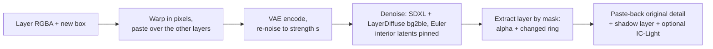
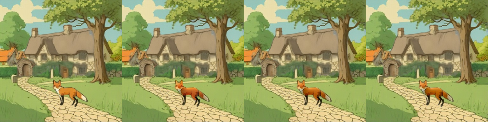
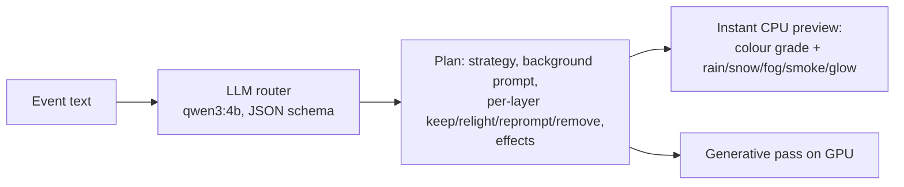
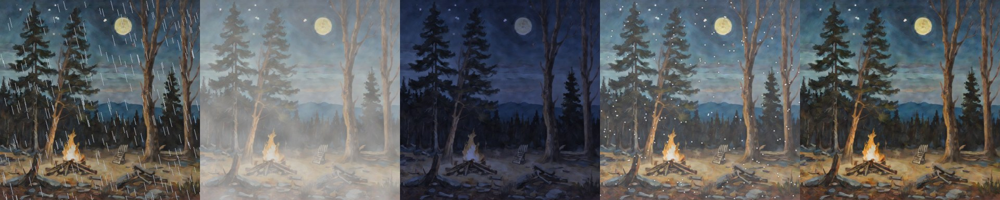
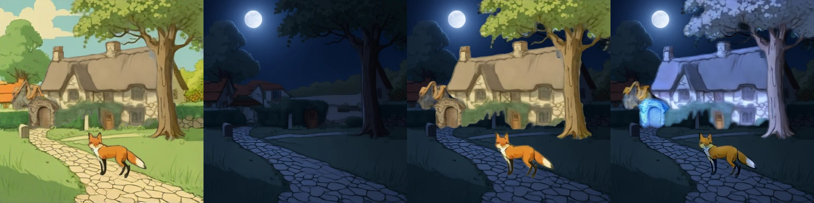
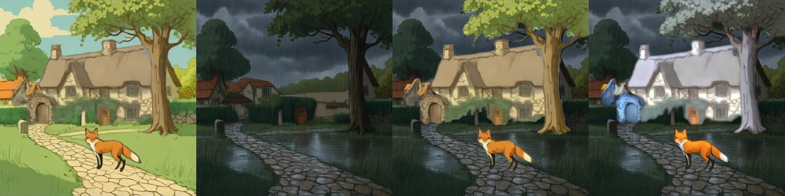
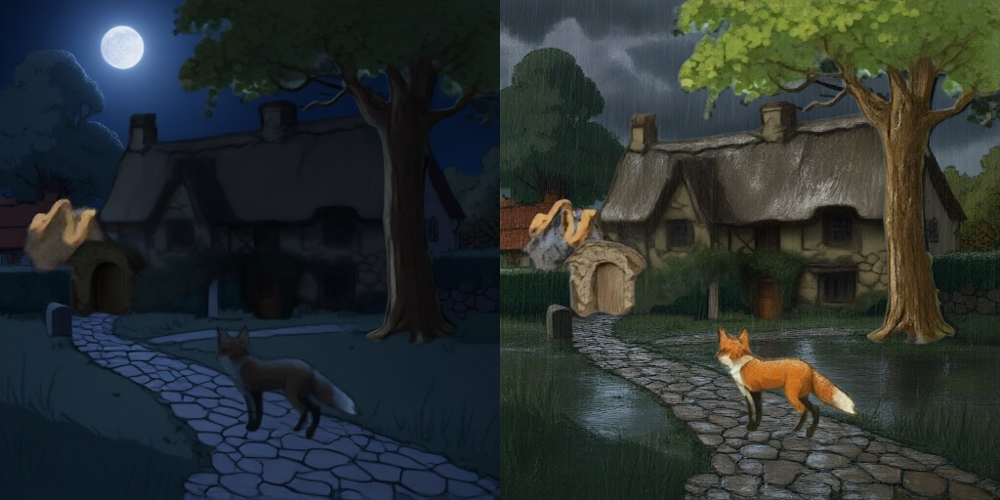

# Editing mechanics: move/resize, relighting, shadows, story events

> **Role: concept (reference).** How the editing steps work and what was measured. Move and resize in the app are direct manipulation in the canvas editor (no model); `relocate()`, IC-Light, the shadow layer and the event router are library code and server routes that are not wired into the page ([../todo.md](../todo.md)). Numbers per model: [../models/README.md](../models/README.md).

## 1. Move / resize with re-harmonisation: `relocate()`

Code: `LayerDiffuseChain.relocate()` in [layerdiffuse_chain.py](../../prototype/layerproto/backends/layerdiffuse_chain.py), served as `/chain/relocate`. About 4 s per edit at 512 px on a T4. Training-free, after DreamLayer's harmonisation step ([../research/papers-survey.md](../research/papers-survey.md#3-move-and-resize-in-the-papers)).

| Parameter | Effect | Tested values |
|---|---|---|
| `strength` | how much of the schedule is redone | 0.3 keeps identity and takes on the new light; 0.5 redraws details; higher broke with a stochastic sampler |
| `pin_frac`, `band` | how long / how tightly the object's interior latents are held (alpha > 40, eroded by `band` px) | every step except the last 2; band 4-9 |
| `paste_back` | blend the original pixels back inside the alpha after decoding | 0.8 kept the moved skeleton's look |
| sampler | Euler (deterministic); DPM++ SDE fought the pinning | Euler |
| extraction | mask (alpha + pixels that changed in a ring) beats LayerDiffuse `bgble2fg` | mask |

**Versions:** v1 (DPM++ SDE, `bgble2fg` extraction) broke down at strength 0.6; v2 (Euler, mask extraction) works; v3 / v4 pinning was a no-op (the pin mask used alpha > 128 eroded by 12 px, about 42 of 4096 latent pixels for the campfire); v5 (alpha > 40, 4 px band, paste-back) holds the interior.

**Limits:** thin parts at the edge (chair legs) can still change; contact shadows are weak; the old position needs inpainting if the background still contains the object (RevealLayer's filled background avoids this); only one object and scene tested (research question RQ4, [../research/research-gap.md](../research/research-gap.md)).

## 2. Relighting and shadows

| Component | What it does | Speed | Code |
|---|---|---|---|
| **IC-Light v1 fbc** (SD1.5, Apache-2.0) | relights a layer to match a given background: the UNet widened 4 → 12 input channels, fg (transparent pixels filled grey) and bg latents concatenated each step; we re-apply the layer's alpha and transfer the original's fine detail | 44 s CPU (8 steps, 384 px); seconds on a T4 [est] | [relight.py](../../prototype/layerproto/relight.py) |
| **Procedural shadow layer** | black RGBA layer under the object: alpha squashed and sheared along the light, blurred with distance, plus a contact blob; one contact line per object; length capped (EasyOmnimatte recipe) | 0.6 s per layer, CPU | [shadow.py](../../prototype/layerproto/shadow.py) |

**Hue drift and its fix** (fox relit in place against the day scene, 384 px, 8 steps): IC-Light lowers the fox's lightness (mean Lab L 54.8 → 46.1) and raises its redness (a* 15.2 → 20.3). `restore_chroma(relit, original, keep)` keeps the relit lightness and pulls the colour back: keep 0.5 gives a* 17.8, keep 0.8 gives 16.4. Tiles: original | relit | keep 0.5 | keep 0.8. The difference is subtle on this fox; it matters when the relit colour is far from the object (night, rain), where keeping too much chroma also removes the intended cast, so `keep` stays a per-event parameter.

IC-Light v2 (FLUX) never released weights, and IC-Light has no notion of light sources (a campfire gets dimmed under "night"). Details and the comparison with Qwen-2.1: [../models/relight-ic-light.md](../models/relight-ic-light.md); literature: [object_harmonisation.md](../../research_notes/Layered%20loop%20open%20paths/object_harmonisation.md).

## 3. Story events across layers

The router was a local Ollama model and is no longer in the app ([../ideas-considered/ollama-option.md](../ideas-considered/ollama-option.md)); `events.py` takes any object with `chat_json`. The instant CPU previews of five events on the forest scene (events in order: *a heavy rainstorm begins*, *thick fog rolls in from the mountains*, *the campfire goes out and it gets very dark*, *snow piles up on everything*, *the wooden chair turns into solid gold*):

| Strategy | When | Generative step | Cost |
|---|---|---|---|
| `bg_relight` | weather, light, time of day | edit the background, relight the objects with IC-Light | Qwen-2.1 edit about 20 s + IC-Light 24-28 s for five layers |
| `per_layer` | several objects change appearance | Qwen-Image-2.1 RGBA edit per layer (keeps alpha) with the alpha check and retry | 2-2.5 min for five layers |
| `recompose` | geometry changes across objects (snow piles up), or the best picture for weather | edit the whole composite (Qwen-2.1: night and heavy-rain edits keep the composition), then re-split ([../models/qwen-image-2.1.md](../models/qwen-image-2.1.md)) | 22 s + split 30-70 s (Stable-Layers) |
| `effects` | only an overlay | procedural rain / snow | instant |

Router rules: lighting changes apply to every visible layer; a layer holding several objects is re-prompted as a whole, never removed for one part. [event_apply.py](../../prototype/layerproto/event_apply.py) applies a plan end to end: per layer keep, edit (with the retry), fall back (colour grade for relight, unedited for reprompt) or remove, a cast-shadow layer under every object, the plan's effects as overlays; the editor is any callable (tested with a stub). No layered method in the literature does story events (gap G2): [story_events_global_edits.md](../../research_notes/Layered%20loop%20open%20paths/story_events_global_edits.md).

## 4. Full move loop on fox & cottage

Input: RevealLayer's fox & cottage split (filled background + 5 layers). The fox is moved 28 % left, 4 % up and scaled 1.15×.

| Step | T4 time | Observation |
|---|---|---|
| naive paste | 0 | no hole at the old place (RevealLayer filled the background) |
| `relocate()` strength 0.3 / 0.45 | 3.4 s per edit (first call 133 s incl. SDXL download) | fox kept, edges blended into the path; 0.3 and 0.45 look alike with paste-back 0.8 |
| + shadow layer | 0.04 s | soft cast shadow on the path, light from the left |
| + IC-Light fbc | 5-6 s (load 43 s) | warmer, redder fox matching the scene; hue shift stronger than wanted |

## 5. Story event, measured: `bg_relight` vs `recompose` (fox & cottage, night and heavy rain)

**`bg_relight`:** Qwen-Image-2.1 edits only RevealLayer's filled **background**; the five object layers are then relit one by one against the scene below with IC-Light fbc. Tiles: day composite | edited background | objects pasted unchanged | objects relit.

| Mean grey level | Night | Rain |
|---|---|---|
| day composite | 148.7 | 148.7 |
| edited background alone | 33.1 | 52.2 |
| objects pasted unchanged | 73.9 | 83.0 |
| objects relit with IC-Light | 65.5 | 85.1 |

- The **background edit is very good** (moon, wet cobblestones, rain streaks, same composition) because the input has no objects to disturb. Pasted objects look like daylight cut-outs on it.
- **IC-Light v1 does not fix that:** it brightens the cottage and tree to a pale blue-grey (night) or white-grey (rain), turns the fox yellowish and darkens only slightly. It has no sense of a night scene's low key.
- **`recompose`** (Qwen-2.1 edits the whole composite, then a splitter) gives dark cottages with lit windows and a consistent result: the better picture for weather and time of day. `bg_relight` keeps the layers exactly as they were, which matters only if the object pixels must not change.

**`per_layer`: Qwen-Image-2.1 relights each object** ("relight this object for a dark night / a heavy rainstorm, keep its exact shape"), about 23 s per layer, composited over the edited background. Where the alpha survives it is **much better than IC-Light** for the large objects: the cottage and tree get genuinely dark or wet, with no colour cast. But the edit does not reliably keep the alpha: in the first run 6 of 10 edits kept it (the fox came back as a fully opaque night scene, the houses opaque or emptied).

**With an alpha check and retry** (accept an edit only if the transparent share stays within 15 points of the input and the visible area between 0.4× and 2.5×, else retry with the next seed 42, 7, 123, 2024; `layer_edit.py`): **all 10 edits accepted, 4 of them on the second try**, 20-26 s per try (547 s in total). Every rejected first try was a flooded scene. Night (left) and rain (right):

The fox now gets a dark, cool look at night and a wet look in the rain. Remaining flaws: the gate-arch layer comes out pale and blobby at night, and objects are relit but not given cast shadows or reflections (the shadow layer of §2 could be added). The three strategies cost about 25 s (IC-Light, colour casts), 2-2.5 min (per-layer Qwen-2.1: best object look, layers unchanged in shape) and 22 s + 30-70 s (`recompose`: best overall picture).
