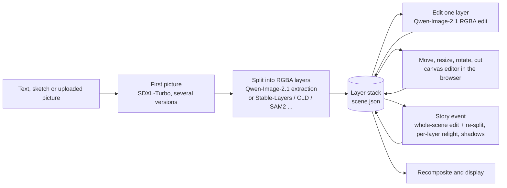
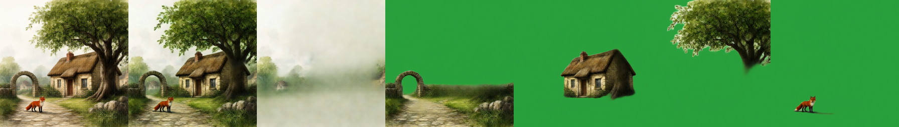
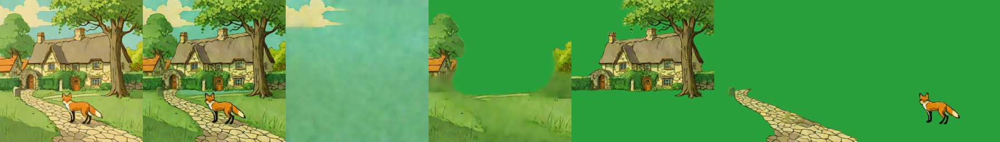

# Architecture: the loop, the routes considered, roles, data model

> **Role: concept.** How the prototype's loop is built and why this route was chosen. Current numbers: [../status.md](../status.md); the verdict per model: [../models/pipeline-plan.md](../models/pipeline-plan.md); move / resize, relighting and story events: [editing.md](editing.md).

## 1. The loop

## 2. Why one picture first, then split it

Generating every object on its own and pasting them gives a **sticker collage**: the objects do not share lighting, perspective or style. The first prototype did exactly that (an LLM split the prompt into nouns, LayerDiffuse drew one layer per noun, boxes placed them). Coherence has to come from one shared image: generate the scene first and split it (this route), or build it element by element on the existing scene (LayerDiffuse's scene-to-layer chain, kept only as the engine of `relocate()`).

**Re-prompting a layer while staying coherent:** never regenerate the layer alone. Take the composite of the other layers as background, the layer's region as mask, draw the new content into that scene and extract it as a layer again. In the app this is the Qwen-Image-2.1 RGBA edit of the layer with an alpha check and retry ([../models/qwen-image-2.1.md](../models/qwen-image-2.1.md)).

## 3. Routes considered (2026-11-07, updated with measurements)

| | Route | Coherence | Move / resize | Measured on free hardware | Verdict |
|---|---|---|---|---|---|
| **A** | picture → splitter (Qwen-Image-2.1 extraction, Stable-Layers, Qwen-Image-Layered) | highest: all layers come from one image | 2D move, `relocate()` | 27-35 s per Qwen-Image-Layered split, Qwen-2.1 about 24 s per object | **chosen** |
| B | background, then each object drawn into the composite so far (LayerDiffuse `bg2ble → bgble2fg`) | high | `relocate()`, lighting baked in | 18 s per element (T4) | not pursued; its engine stays for `relocate()` |
| C | picture → SAM2 (grounded by names) → fill | as good as the source; hidden parts missing | 2D; a moved object leaves a bite | 3-7 s; grouping poor without names | kept as the fast-mask option |
| D | native joint models (ART+, PSDiffusion, DreamLayer, LASAGNA) | high in the papers | DreamLayer only | ART+ runs but does not fit our scenes; the others are unreleased | dropped |
| E | layout first (boxes), whole-canvas image to image, then split | high, respects placement | placement fixed up front | untested | open |
| F | picture + boxes → RevealLayer or CLD | high; hidden parts and background filled | moving reveals no hole | 134 s (RevealLayer) | kept for boxes and inpainting |

### Which generator feeds the splitter? (run v11, 384 px, 2× T4)

The same splitters on three generated scenes (tiles: image | recomposite | background | layers):

| Generator → scene | Splitter | Time | Recomposite diff | What came out |
|---|---|---|---|---|
| FLUX.1-dev (campfire in a pine forest) | Stable-Layers, Heun | 57 s | 11.0 | two tree groups, the campfire as its own layer, an empty clearing as background |
| FLUX.1-dev | base, Euler | 32 s | 6.3 | 3 frames mostly empty |
| Qwen-Image-2.1 (fox & cottage from the caption) | Stable-Layers, Heun | 66 s | 21.2 | arch + path, cottage, tree, fox; mist-like background |
| Qwen-Image-2.1 | base, Euler | 36 s | 17.4 | 4 object frames, uneven |
| SDXL-Turbo (the shared fox & cottage) | Stable-Layers, Heun | 66 s | 20.7 | sky, meadow, cottage + tree together, path, fox |
| SDXL-Turbo | base, Euler | 36 s | 16.7 | 4 frames, fox and cottage separated |

Every generator gives a separable picture; scenes with clearly spaced objects and visible depth split most cleanly, SDXL-Turbo's overlapping cottage and tree stay together. Stable-Layers gives cleaner layers but shifts colour (diff 11-21 against 6-17) and takes about 30 s longer. One scene and one seed per generator: this compares examples, not generators. SDXL-Turbo was chosen for speed (about 1.5 s on a T4).

## 4. Roles (one model per role, each behind its own interface)

| Role | Default | Alternatives | Runs on |
|---|---|---|---|
| first picture (text, or sketch / picture as image to image) | SDXL-Turbo | Qwen-Image-2.1 text to image, FLUX.1-dev GGUF | Kaggle (shared session) |
| split into layers | Qwen-Image-2.1 extraction of named objects | Stable-Layers, Qwen-Image-Layered, CLD, RevealLayer, SAM2 + Grounding DINO + LaMa | Kaggle (shared session, others in their own) |
| edit one layer | Qwen-Image-2.1 RGBA edit with alpha retry | - | Kaggle |
| move, resize, rotate, cut, reorder | canvas editor (no model) | `relocate()` re-harmonise (LayerDiffuse SDXL, server route only) | browser |
| relight, shadows | Qwen-2.1 per-layer relight; procedural shadow layer | IC-Light (library, not wired) | Kaggle / CPU |
| story event | whole-scene Qwen-2.1 edit, then re-split | LLM router with instant CPU previews (library; needs a planner, [../ideas-considered/ollama-option.md](../ideas-considered/ollama-option.md)) | Kaggle |
| recomposite | alpha compositing (`Engine.compose`, the same rule in the editor) | - | laptop / browser |

## 5. Data model (`scene.json`, one folder per scene under `prototype/scenes/`)

| Object | Fields |
|---|---|
| Scene | id, the description, ordered layers |
| Layer | name, role (`background` / `object`), depth, enabled, the selected variant, transform `dx`, `dy` (fraction of the canvas), `scale` and `rot` (degrees) around the layer's visible centre (the box of alpha above 24), a planned box, `variants` |
| Variant | a full-canvas RGBA PNG, seed, prompt, mode (the splitter's method, `edit`, `edit-unchecked`, `hand`), seconds, share of transparent pixels |
