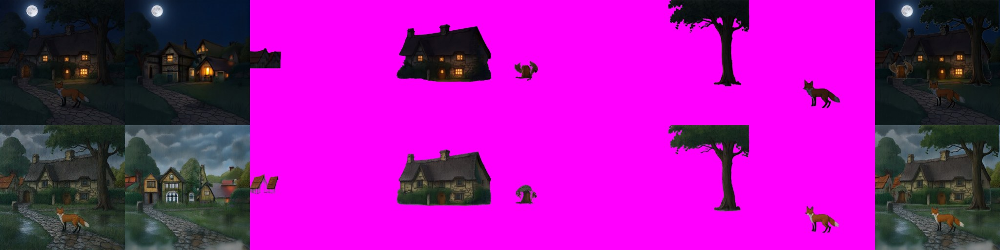
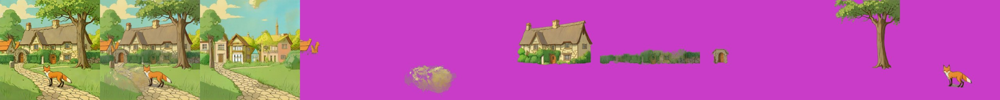
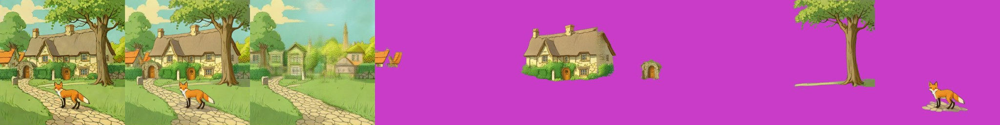

# CLD (Controllable Layer Decomposition)

> **Role: current factsheet** (optional splitter). Template: [TEMPLATE.md](TEMPLATE.md). Verdicts are the owner's.

> **Owner assessment (2026-11-11):** Layer extraction is pretty decent, but slow. Adding replacement backgrounds is interesting. The Qwen-Image-2.1 night and heavy-rain edits split with CLD show good style variation (that variation is Qwen-2.1's, [provenance.md](provenance.md)). Keep Stable-Layers and CLD as options for splitting unless Qwen-2.1 has an absolute advantage; runtime matters too.

## What it does

Image + caption + one box per layer → RGBA whole image, an RGBA background and one RGBA layer per box. Fine-tuned FLUX.1-dev (ART base LoRA + PrismLayers fine-tune + decouple LoRA) with an inpainting ControlNet adapter; rank-64 LoRA trained for 25K iterations at 1024² on the PrismLayersPro training split; it reuses ART's transparent decoder. The `pre_trained_LoRA` is byte-identical to the ART base LoRA; `prism_ft_LoRA` is either ART+ PrismLayersPro or CLD's own fine-tune (the paper does not settle which).

## Licence & weights

Code MIT ([monkek123King/CLD](https://github.com/monkek123King/CLD)); weights `thuteam/CLD` (Apache-2.0; LoRAs 598 MB each, transparent VAE 1.02 GB) + `alimama-creative/FLUX.1-dev-Controlnet-Inpainting-Alpha` (4.28 GB); FLUX.1-dev is non-commercial.

## How we run it (happy path)

Kaggle 2× T4, server profile `cld` ([`layerproto/serve/cld.py`](../../prototype/layerproto/serve/cld.py)). GGUF Q4_K_S FLUX.1-dev re-classed into CLD's custom transformer; the three LoRAs and the MultiLayerAdapter + its LoRA attached unmerged with `fp16_mixed` (the wrapper had to learn list outputs); diffusers 0.32.2 (a one-line import patch for `BaseOutput`); 512 px, 16 steps, CFG 4, adapter scale 0.9; boxes snapped to 16 px.

**Memory recipe** (what made 768 px fit; 1024 px with 2 steps also ran but gives noise): the **adapter on GPU 1** with forward hooks moving its inputs there and its outputs back to GPU 0; the **text encoders on the CPU in bf16** (prompt embeddings cast to fp16 on GPU 0 and cached per caption); the adapter gets **its own copy of `layer_pe`**, because `adapter.to(GPU 1)` otherwise also moves the transformer's shared parameter. Weights then are 7.0 GiB on GPU 0 and 4.0 GiB on GPU 1; load about 300 s.

## Results on fox & cottage

Layers of the first run (512 px, five boxes, 16 steps): village houses 1.8 % alpha (two small orange roofs), cottage 26 % (clean cut-out incl. hedge), gate arch 2.1 % (small arch with door), tree 17 % (trunk + crown, clean edges), fox 2.5 % (clean, correct pose). With seven boxes (the five + path + hedge) the hedge comes out as a clean strip, but the **path is a faint blotch**: a ground plane is not extracted as an object. At 768 px (7 boxes, 16 steps) the layers are as clean as at 512 px: 1380 s after a 288 s load, 10.8 GiB on GPU 0.

**Story-event composites:** CLD splits the Qwen-2.1 night and heavy-rain edits with the same boxes (the edits keep the composition; 512 px, 16 steps, about 6 min per case). Tiles: whole | background | houses | cottage | gate arch | tree | fox | merged; top row night, bottom row rain. The layers keep the edit's look (lit windows, dark roof, wet greenery) and are clean cut-outs (cottage 27 % of the canvas, tree 17 %, fox 2 %); the arch comes out as a small stump-like object.

**Background: CLD vs RevealLayer.** Compare the background tile of the CLD strip A below (third tile) with the background tile of the [RevealLayer strip](../img/bench_reveallayer_A.jpg).

- **CLD's background layer is its own generation**: a village street with houses, trees and a path (lit windows at night, mist in the rain), not the scene without its objects. Moving an object over it puts it into a different scene, so with CLD the background has to come from elsewhere (RevealLayer's, SAM2 + LaMa or a fill) if objects are to be moved; for story events an invented background is acceptable, for exact preservation it is not.
- CLD's merged output (the layers put back together) matches the original, with a smeared patch on the path where the fox was. RevealLayer's background is the same scene with the objects taken out and filled; the cottage is partly cut away, which shows when objects move.

## Benchmark (warm model in one Kaggle session, 2026-11-11, second of two runs)

Adapter on GPU 1, text encoders on the CPU, 512 px. The second run reuses the cached prompt embeddings; the first also pays the CPU text encoding (674.9 s for case A), so a new caption costs about 215 s extra.

| | Settings | Compute (second run) | Layers | Recomposite diff |
|---|---|---|---|---|
| **A. Best case** | seven boxes (five objects + path + hedge), 16 steps | 459.3 s | 8 | 13.39 |
| **B. Cheapest setting tried** (not under 30 s) | five boxes, 4 steps | 115.8 s | 6 | 11.96 |

4 steps already give usable object layers (cottage, tree and fox extracted cleanly with their own ground shadows; the "background" is again a different village) at a quarter of the 16-step time. Two steps at 768 px gave noise.

## Special features

| Feature | Status | Evidence |
|---|---|---|
| Split an image into layers (with boxes) | **supported** | benchmark above |
| Move / resize a layer | **partial**: the generated background is a different scene | background comparison above |
| Story composite | **split only**: it splits Qwen-2.1's night and rain edits | `cld_night_rain.jpg` |
| Spatial edit | **supported**: the boxes control the grouping | seven-box run |
| Amodal completion | **partial**: objects come out whole, the background is invented | |
| Image to image, relight, effects | n/a | |

## Best features / Weak spots

- **Best:** controllable decomposition by boxes with a re-rendered, consistent whole image, a filled background and layers that keep the input's style (unlike ART+).
- **Weak:** slow (116-459 s); needs an input image and boxes (not text → layers); three LoRAs + ControlNet are memory-tight; the invented background; a ground plane is not extractable; FLUX.1-dev non-commercial.

## Status / Next attempts

Works. Next: compare moving a layer over CLD's background and RevealLayer's, more boxes (rocks), timing with fewer steps ([../todo.md](../todo.md)). Sources: the CLD paper (arXiv 2511.16249), [flux_layered_t4_and_weights.md](../../research_notes/Layered%20loop%20open%20paths/flux_layered_t4_and_weights.md).
