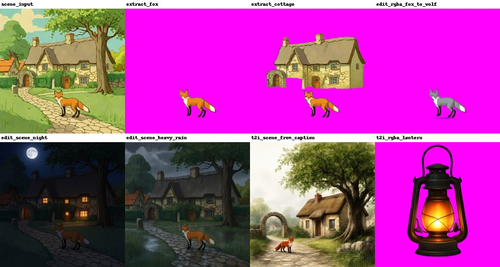
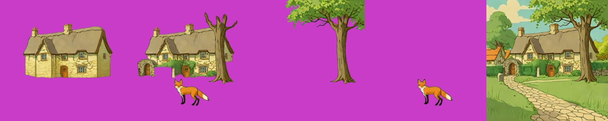
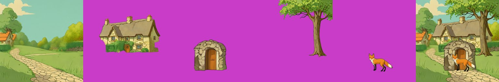
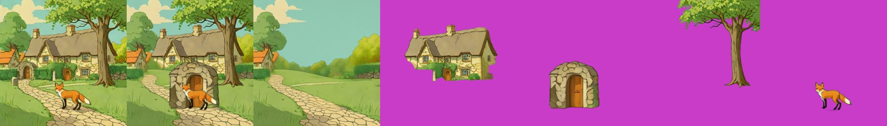
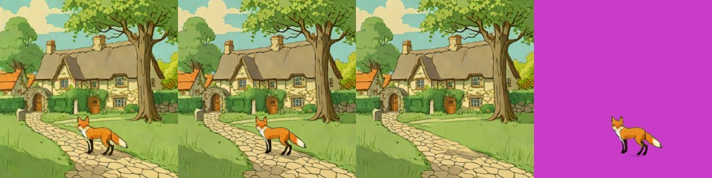
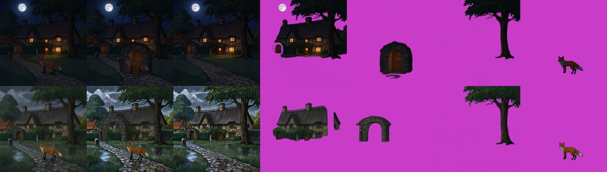
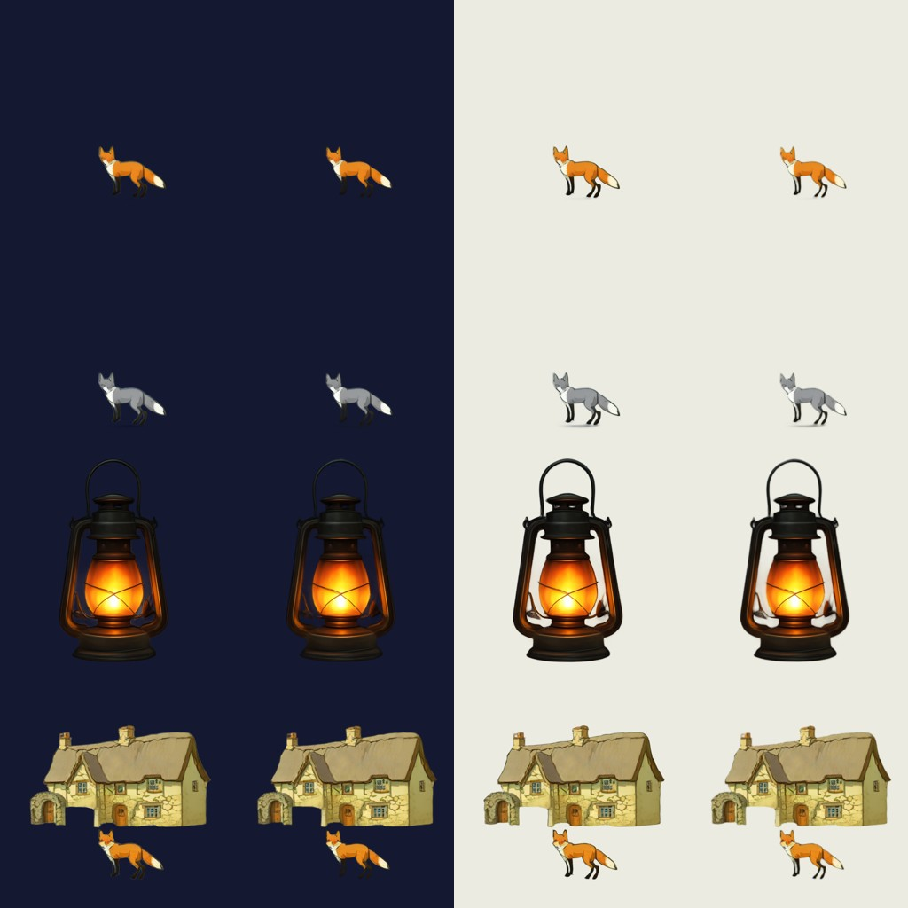

# Qwen-Image-2.1 (RGBA)

> **Role: current factsheet; the core model of the prototype.** Template: [TEMPLATE.md](TEMPLATE.md). Verdicts are the owner's.

> **Owner assessment (2026-11-11):** Very useful for scene editing and story-event composites. Also a useful decompose method (with successful background inpainting) and good layer splitting together with Stable-Layers. A bit slow (maybe better for adding single layers or modifying scenes). The only model here that supports image to image. After the attribution audit: SDXL-Turbo makes the first picture and Qwen-2.1 splits and modifies it ("probably the best core path"; [pipeline-plan.md](pipeline-plan.md)).

## What it does

7B text-to-image and editing model with a native 4-channel (RGBA) VAE: generates transparent images, **edits a transparent layer**, **extracts a subject** from an image, local and multi-reference edits. No multi-layer split mode (no announced Layered 2.x, no community decomposition LoRA).

## Licence & weights

Qwen Research licence (non-commercial). `Qwen/Qwen-Image-2.1(-Turbo)`; GGUF `unsloth/Qwen-Image-2.1-Turbo-GGUF` (Q4_K_S, 3.91 GB); fp16-safe VAE `madebyollin/texture-fix-vae-for-qwen-image-2.1` (the stock VAE gives NaNs in fp16 on transparent pixels). The weights are cached as Kaggle notebook outputs (`weights-qwen21-text-encoder` 17.5 GB, `weights-qwen21-parts` 5.3 GB) so a session reads them instead of downloading them.

## How we run it (happy path)

1. Kaggle 2× T4, diffusers `main`, transformers ≥ 5.17; the server profile is [`layerproto/serve/qwen21.py`](../../prototype/layerproto/serve/qwen21.py) (alone) or `studio.py` (next to SDXL-Turbo, with only 2.5 GiB of the text encoder on GPU 0).
2. Turbo GGUF Q4_K_S transformer on GPU 0 with its non-Linear GGUF parameters dequantised and `fp16_mixed` ([../concepts/fp16-on-t4.md](../concepts/fp16-on-t4.md)); Qwen3-VL text encoder in fp16 split over both GPUs; texture-fix VAE. Load about 380 s in the notebook, 8.0 / 12.7 GiB.
3. 512 px, 8 steps (Turbo schedule), CFG 1. Transparent output: wrap the prompt as "This is an RGBA image with transparency. … The image has alpha channel and the background is transparent." Edits: pass the image(s) as `image=[...]`. Strong, explicit edit prompts ("Keep every object, the composition and the style") fixed the subtle rain edit.
4. In the app it serves `qwen21-extract` on `/decompose` and the layer edit (alpha check and retry) on `/edit`.

## Benchmarks (512 px, Turbo, T4 × 2)

| Task | Time | Result |
|---|---|---|
| Text → transparent object (campfire, lantern) | 17-23 s | 37 % transparent / 50 % opaque; dark smoky halo; lantern clean with a glow |
| RGBA edit of a layer ("blue flames", fox → grey wolf) | 23 s | edit applied, alpha kept |
| Extract an object from a scene | 22-27 s | clean layer at its original position |
| Remove an object ("fox removed, path filled") | about 24 s | path and grass filled, the rest unchanged |
| Text → opaque scene | 18 s | good |
| Scene edit: night / heavy rain | 22 s | strong and convincing, composition kept (moon, lit windows / storm clouds, rain streaks, wet cobbles) |

Fox & cottage sheet (extract fox, extract cottage, fox → wolf, night, heavy rain, scene from caption, lantern). The extract-fox prompt that worked is ComfyUI's background-removal wording ("Remove the background, and output a PNG image. Keep only the red fox …"); the RGBA-wrapper prompt returned an empty image for it. "Extract cottage" brought the fox along.

## Extracting single objects (run 2026-11-10)

One scene picture in, one object out as RGBA, about 23-27 s each. Panels: cottage (prompt a), cottage (prompt b), tree, fox, scene with the fox removed.

- **Cottage, prompt a** ("only the cottage ... without the tree, fox, arch or hedge in front"): a whole, clean cottage with the hidden parts completed: the best amodal result so far, better than the SDXL-inpaint fill. **Prompt b** ("complete the parts hidden behind the tree and the arch") brought the tree, arch and fox along: the wording "without X" works, "complete the hidden parts" does not.
- **Tree:** clean cut, the crown clipped at the top edge. **Fox:** clean cut, 97 % transparent.

## As a split method (`qwen21-extract`)

[qwen21_decomposer.py](../../prototype/layerproto/backends/qwen21_decomposer.py): one "remove all named objects" call for the background, then one extract call per name from the original image, each naming the objects in front of it as exclusions, retrying with the next seed when a layer comes back empty or flooded. `MethodRouter` lets one server offer it next to `sam2-lama`.

- The **background** comes out clean, hole-free and coherent with every named object removed (the SAM2 + LaMa background is smeared where the cottage and tree were); cottage, tree and fox are whole and clean.
- The **arch** came back larger than in the scene (the prompt carries no position, so the model redraws it big) and overlaps the fox; boxes are not used for position. Next: pass the box as a crop or position hint, or paste the extracted object back into its box.

**Benchmark (warm model in one session, 2026-11-11, second of two runs):**

| | Request | Compute | Layers | Recomposite diff |
|---|---|---|---|---|
| **A. Best case** | background + four objects (cottage, arch, tree, fox) | 118.6 s | 5 | 17.17 |
| **B. Live-demo budget** | background + one object (the fox) | 47.6 s (two edit calls) | 2 | 5.71 |

Every object is one 24 s call and the background one more, so a 30 s request can ask for one thing. Live in the shared session: 2 objects + background 69 s, one layer edit 24 s ([../status.md](../status.md)).

## Extraction on the night and rain edits (session `qwen21-story`)

The same method on Qwen-2.1's own night and rain edits (background + four objects; night 138.7 s, rain 184.3 s). Rows: night, rain; tiles: input | recomposite | background | cottage | arch | tree | fox.

- **The background layer still contains the cottage and the tree** (colour difference of the background to the input inside the cottage / tree / fox masks: night 3.9 / 2.5 / 14.5, rain 15.9 / 11.2 / 32.1; about 4 means unchanged); on the daylight scene the same request emptied the background.
- **The cottage layer is a block** (night 45.5 % of the canvas with the moon and the top of the tree in it; rain 22.5 % with holes). **The arch is invented and misplaced** (a large stone dome at night covering the fox; in the rain an arch spanning over the cottage). The tree and the fox are fine.
- **Stable-Layers at 640 px** on the same two edits gave one clean layer per object with a hole-free background (178 s with Heun, [stable-layers.md](stable-layers.md)): a measured advantage for splitting these story composites, one seed and one prompt set. Qwen-2.1 remains the model that made the edits. The earlier re-split of the edits at 384 px: night diff 4.2 (moon + sky bits / cottage with lit windows / tree / fox), rain diff 11.2; the base Qwen-Image-Layered split the night edit worse (3 of 4 object frames empty).

## Halo / fringe fix (`layerproto/matte_fix.py`)

Removes the grey-green rim of generated transparent objects (visible on dark backgrounds) but also softens the fox's dark outline; apply it when a layer is moved onto a very different background, not by default.

## Usage facts

| Topic | Fact |
|---|---|
| Alpha design | the VAE takes 4-channel RGBA in and out (64-channel latent, 16× downsampling); generation and editing share one pipeline; only the transparency wrapper is an official prompt |
| References | up to 10 reference images; `image_1` is the image being edited; placement only by prompt and circle / mask images, no coordinates |
| Alpha quality | no measured benchmark; one provider guide reports near-binary alpha; about 20 % of the lantern's and 21 % of the fox's visible pixels are semi-transparent in our runs |
| Speed-ups | Turbo (8 steps), Lightning LoRA, Fun-Acc LoRA (4 steps); KV cache (same image on and off) |
| fp16 | stock VAE NaNs on transparent pixels (texture-fix VAE fixes it); the diffusers GGUF loader leaves a non-Linear parameter packed, fixed by dequantising it after loading |

Sources and the cited findings: [qwen_image_21_rgba.md](../../research_notes/Layered%20loop%20open%20paths/qwen_image_21_rgba.md).

## Special features

| Feature | Status | Evidence |
|---|---|---|
| Split an image into layers | **supported** (one call per object) | above |
| Move / resize a layer | **partial**: a canvas move; the background without the object comes from this model | [amodal-fill.md](amodal-fill.md) |
| Harmonise after a move | **tried**: a convincing shadow but redraws the picture | [relocate-harmonise.md](relocate-harmonise.md) |
| Story composite | **supported**: whole-scene night and rain edits, then a re-split | [../concepts/editing.md §5](../concepts/editing.md) |
| Spatial edit, image to image | **supported**: "fox → grey wolf" in the same pose and style, alpha kept; scene edits | sheets above |
| Add / remove / modify a layer | **supported**: extract, remove, RGBA edit, text → transparent object | above |
| Relight a layer | **supported** with an alpha retry: 10 of 10 edits accepted | [relight-ic-light.md](relight-ic-light.md) |
| Effects as layers | **partial**: lantern prop with a glow; procedural overlays for rain / snow | sheet above |
| Amodal completion | **supported**: whole cottage behind the tree | extraction strip |

## Best features / Weak spots

- **Best:** one model covers new layer from text, re-prompt a layer keeping transparency, cut an object out of a scene, remove an object, scene edits and relight; follows prompts well; about 20-25 s per call.
- **Weak:** halo around generated transparent objects; the alpha edit can return an opaque or emptied layer (hence the retry, and an edit can be accepted yet unchanged); extraction ignores position and scale and leaves objects in the background on night and rain edits; every call re-renders the picture slightly (about 31 dB against the input even when told to change nothing); non-commercial licence.

## Status / Next attempts

Core of the prototype, served live in the shared session. Next: pass the box to the extraction, an edit-success check, a harmonise with a lighting mismatch, compare with other image-to-image models, transparent effect layers (fog, glow, snow) ([../todo.md](../todo.md)).
