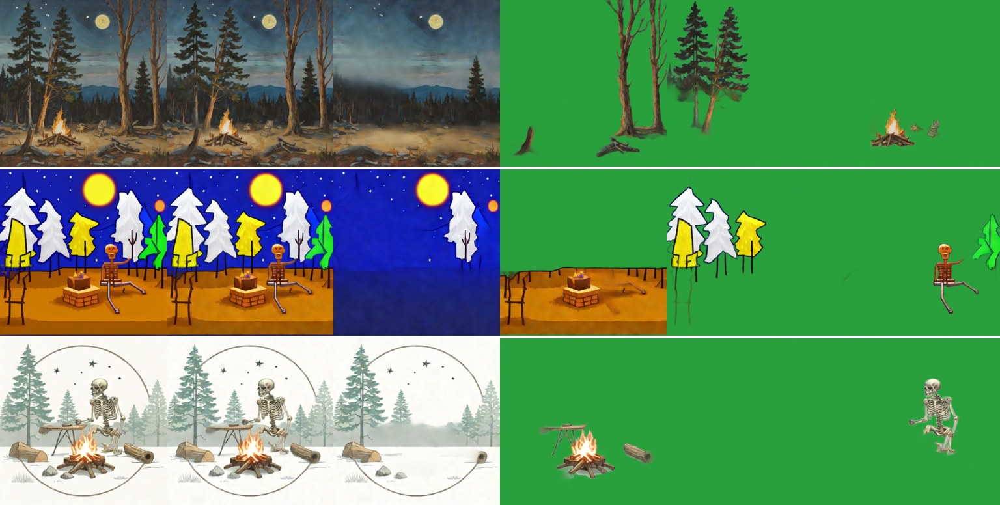
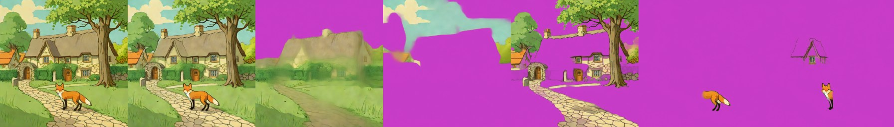
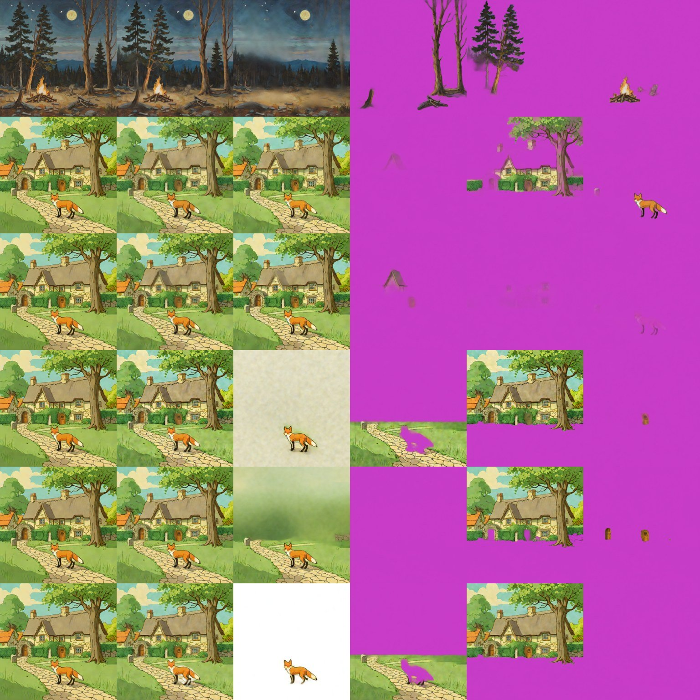

# Qwen-Image-Layered

> **Role: current factsheet** (base of Stable-Layers; kept in contention). Template: [TEMPLATE.md](TEMPLATE.md). Verdicts are the owner's.

> **Owner assessment (2026-11-11):** Surprisingly bad layer extraction in some cases, pretty decent in others: quite inconsistent. Keep it in contention; it could still have advantages over Qwen-Image-2.1 with further testing.

## What it does

Splits one finished image into N full-canvas RGBA layers (N chosen per run, e.g. 3-8) that composite back to the input; hidden areas behind objects are filled. 20B MMDiT, image → layers (not text → layers, no boxes).

## Licence & weights

Apache-2.0, [Qwen/Qwen-Image-Layered](https://huggingface.co/Qwen/Qwen-Image-Layered). We use a GGUF Q4_K_S transformer (12.4 GB) plus the original text encoder and VAE, cached as public Kaggle notebook outputs (`markandreduesing/qwen-layered-weights-transformer`, `-base`).

## How we run it (happy path)

1. Kaggle 2× T4, transformer split over both GPUs (blocks 0-29 / 30-59), `fp16_mixed` ([../concepts/fp16-on-t4.md](../concepts/fp16-on-t4.md)); profile `qwen-layered` ([`serve/qwen_layered.py`](../../prototype/layerproto/serve/qwen_layered.py)), load about 354 s.
2. Fast setting: **384 px, 4 layers, 4 steps, `true_cfg=1.0`** → 27-35 s. Native 640 px is about 97 s.
3. Code: [`qwen_layered.py`](../../prototype/layerproto/qwen_layered.py) (`decompose`, `recompose`, `cached_encode`, `HeunVelocity`); guide [../guides/kaggle.md](../guides/kaggle.md).

## Benchmarks (2× T4)

| Setting | Time per split | Recomposite diff | Notes |
|---|---|---|---|
| 640 px, 4 layers, 50 steps, CFG 4 (defaults) | 35 min | 4.1 | reference quality, forest only |
| 512 px, 3 layers, 12 steps, CFG 1 | 139 s | | same split as CFG 4 |
| **384 px, 4 layers, 4 steps, CFG 1** | **27-35 s** | about 7 | fast setting |
| 512 px, 4 layers, 4 steps | 48 s | | sharper |
| 384 px, 4 Heun steps | 58 s | 7.0 | 2 calls per step |
| 384 px, 2 layers, 4 steps | 25.7 s | 5.9-6.5 | background + one foreground layer |

One 640 px, 4-layer step is about 6.6 × 10¹⁴ FLOPs, about 35 s at the T4's 19 TFLOPS, so the defaults cannot reach a 30 s budget; lower resolution, CFG 1 and 4 steps do. Peak memory 8.0 / 7.6 GB.

**Forest, pixel-art and sketch scenes** (384 px, 4 layers, 4 steps) split meaningfully: background, tree groups, campfire group, characters. Tiles: input | recomposite | background | other layers on green.

**Fox & cottage** (profile runs, warm model, second run):

| Settings | Compute | Diff | What the layers show |
|---|---|---|---|
| 384 px, 4 layers, 4 steps | 34.5 s | 8.68 | nothing taken out of the background; a ghost, a top slab, the fox |
| 512 px, 5 layers, 16 steps | 254.8 s | 8.54 | objects mixed across layers; the fox cut across several (background 67.5 % opaque, objects partly removed) |

The 384 px, 4-step run is the same case as row 2 of the diagnosis strip below (nothing taken out of the background).

16 steps cost 7× the time and barely change the recomposite difference, which does not measure separation: duplicated content recomposites perfectly.

## Diagnosis: why the fox & cottage scene fails (2026-11-11)

The forest runs were good, the fox & cottage splits are not. One session ran the forest as a control and the fox scene at other settings. Rows: forest 384 px (control), fox 384 px, fox 384 px with an empty caption, fox 640 px 4 steps, 640 px 20 steps, 640 px 12 steps CFG 4. Strip: input | recomposite | layer 0 | layers 1-3 (magenta = transparent).

"Still in the background" is the colour difference between layer 0 and the input inside the SAM2 masks of cottage / tree / fox: about 10 means the object was not taken out.

| Row | Compute | Cottage / tree / fox in background | What the layers are |
|---|---|---|---|
| forest 384 px (control) | 35.1 s | n/a | a real split: background, bare trees, pines, campfire |
| fox 384 px, 4 steps | 32.6 s | 8.8 / 10.5 / 11.5 (all three) | a roof ghost, a top slab with sky, tree and cottage (duplicate), the fox |
| fox 384 px, empty caption | 33.3 s | 9.5 / 8.9 / 9.7 | nothing extracted (fragments only) |
| fox 640 px, 4 steps | 88.2 s | 70.8 / 111.8 / 9.8 | blank wash background with the fox in it; ground slab; top slab with sky + tree + cottage |
| 640 px, 20 steps | 431.9 s | 32.7 / 78.4 / 5.9 | same, one layer empty |
| 640 px, 12 steps, CFG 4 | 516.9 s | 117 / 156 / 25.1 | same, one layer empty |

- **Not a code regression:** the forest control reproduces the good old result with current code and weights.
- On fox & cottage the base model returns **no object layers at any setting**: nothing is taken out at 384 px; at 640 px the picture is cut into a top block and a ground slab and the fox stays in the background. More steps and CFG 4 do not change that; the empty caption makes it worse, so the caption is not the cause.
- **Why the forest works and this scene does not is not established.** Candidates: the scene (flat cartoon colours, dense overlap, no depth cues), our Q4_K_S GGUF with `fp16_mixed` on a T4, or the model itself. A full-precision run (hosted API about $0.05 per run, [../research/hosting.md](../research/hosting.md)) would separate numerics from model; not run, the owner decides.
- The Stable-Layers LoRA on the same weights does split this scene at 640 px ([stable-layers.md](stable-layers.md)).

**Native 640 px, 5 layers, base model (Euler 4 steps):**

| Case | Compute | Layers |
|---|---|---|
| fox & cottage | 97.0 s | blank cream background with the fox in it; ground slab with a fox-shaped hole; top slab; cottage + tree together with holes; a fragment |
| night composite | 98.8 s | blank white background; smears; **layer 3 holds the complete night scene** (100 % opaque) |
| rain composite | 98.4 s | white background; the scene with holes twice; the fox |

Strips: [qwenlayered_640_fox.jpg](../img/qwenlayered_640_fox.jpg) (row 1), [qwenlayered_640_story.jpg](../img/qwenlayered_640_story.jpg) (rows 1 and 4). Re-splitting at 384 px after Qwen-2.1's edit: night worse than Stable-Layers (3 of 4 object frames 99-100 % transparent), rain diff 10.8. Re-decomposing every turn loses quality ([../research/drift-evaluation.md](../research/drift-evaluation.md)).

## Special features

| Feature | Status |
|---|---|
| Split an image into layers | **supported** (scene-dependent, see above) |
| Move / resize a layer | **partial**: full-canvas RGBA, canvas move works; no harmonising ([relocate-harmonise.md](relocate-harmonise.md)) |
| Story composite | the edit is Qwen-2.1's; this model only splits it, poorly ([provenance.md](provenance.md)) |
| Add / remove / modify a layer | **partial**: choose N; edit a layer with [Qwen-2.1](qwen-image-2.1.md) |
| Amodal completion | **supported** (hidden areas filled; faint ghosts of old positions remain) |
| Spatial edit, image to image, relight, effects | n/a |

## Best features / Weak spots

- **Best:** the most meaningful semantic layers of all routes on painterly, pixel-art and sketch scenes; recomposites almost exactly; background filled behind objects.
- **Weak:** inconsistent (fails on the flat fox & cottage scene); groups unrelated objects (skeleton + tree); thin or low-contrast subjects may stay in the background; at 384 px detail is limited; ghosts in the background.

## Status / Next attempts

Works on some scenes; the Stable-Layers LoRA is the better splitter for our scenes. Next: Heun at 8 steps, the full-precision check, TPU route ([../research/hosting.md](../research/hosting.md#3-tpu)). Sources: paper arXiv 2512.15603; [../log.md](../log.md); [qwen_layered_and_layerdiffuse_papers.md](../../research_notes/Coherent%20layered%20generation%20pipeline/qwen_layered_and_layerdiffuse_papers.md).
