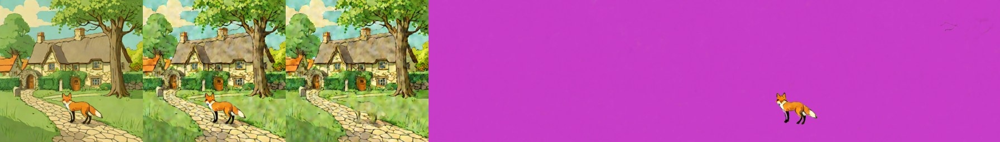
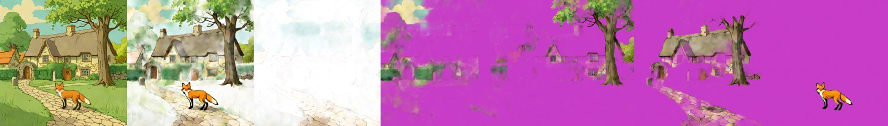

# Qwen-Image-Lightning LoRA (on Qwen-Image-Layered)

> **Role: current factsheet** (tested, not recommended). Template: [TEMPLATE.md](TEMPLATE.md). Verdicts are the owner's.

> **Owner assessment (first look, 2026-11-11):** As bad at layer extraction as Qwen-Image-Layered. Maybe ok for story composites; worth seeing whether that can be improved, otherwise discard. (Measured below: not improved.)

## What it does

lightx2v's distillation LoRA for plain Qwen-Image (4-8 steps), here attached to Qwen-Image-Layered, which nobody had tried before.

## Licence & weights

`lightx2v/Qwen-Image-Lightning` (Apache-2.0 per card).

## How we run it (happy path)

Attach unmerged with `fp16_mixed.add_lora` (all 720 modules match Layered), Lightning scheduler config from the card, 5 layers, 2 or 4 steps, scale 1.0 (profile `qwen-layered`).

## Benchmarks (2× T4)

Fox & cottage, 384 px, scale and steps swept (base model Euler 4 steps for reference: 39 s, diff 6-8, all five objects):

| Scale | Steps | Total | Diff | Layers look |
|---|---|---|---|---|
| 0.25 | 2 | 22.5 s | 32.3 | not split |
| 0.5 | 2 | 22.5 s | 22.1 | partial |
| 1.0 | 2 | 22.4 s | 15.0 | tree + fox, cottage almost empty |
| 0.5 | 4 | 43.6 s | 11.1 | cottage + tree + fox, cleanest of the sweep |
| 1.0 | 4 | 43.9 s | 13.8 | tree and fox, cottage nearly empty |

Profile runs (warm model): 512 px, 4 steps, 73.8 s, diff 14.4: the background still holds the cottage and tree, layers 1-2 empty, only the fox extracted:

384 px, 2 steps, 22.5 s, diff 56.4: colours washed out, layers 1-3 large overlapping slabs, the recomposite no longer resembles the input:

**Native 640 px** (strips: [qwenlayered_640_fox.jpg](../img/qwenlayered_640_fox.jpg) rows 4-5, [qwenlayered_640_story.jpg](../img/qwenlayered_640_story.jpg) rows 3 and 6):

| Case | Compute | Layers, checked |
|---|---|---|
| fox & cottage, 4 steps | 112.2 s | background still holds the scene, layer 1 empty, the tree twice, a pink half-transparent fox fragment; cottage not extracted |
| fox & cottage, 2 steps | 57.4 s | the same, with a pink ghost of the cottage |
| night composite, 4 steps | 112.8 s | background is the whole night scene; fox; a smear of cottage and tree; ghost of the moon |
| rain composite, 4 steps | 112.5 s | two layers hold the whole scene; fragments; not split |

**Story composites are not improved at 640 px**: Lightning leaves the cottage in the background or smears it, duplicates the tree and damages the fox, while [Stable-Layers](stable-layers.md) on the same edits gives one clean layer per object. At 4 steps Lightning is not faster than Stable-Layers Euler (112 s against 102 s).

## Special features

| Feature | Status |
|---|---|
| Split an image into layers | **supported** but below the base model (worse at 2 steps) |
| Story composite | splits a night / rain edit poorly (384 and 640 px) |
| Everything else | n/a (as [the base model](qwen-image-layered.md)) |

## Best features / Weak spots

- **Best:** separates thin, low-contrast subjects better (the pale skeleton came out cleanly).
- **Weak:** no speed-up at 4 steps (the base already works there), about 5 s LoRA overhead, colour and texture drift, objects left in the background.

## Status / Next attempts

Tested in sweeps and at 640 px; not part of the pipeline. Use only for hard thin / low-contrast scenes where the base fails; for speed prefer the base model at 2 layers. Sources: [../log.md](../log.md).
