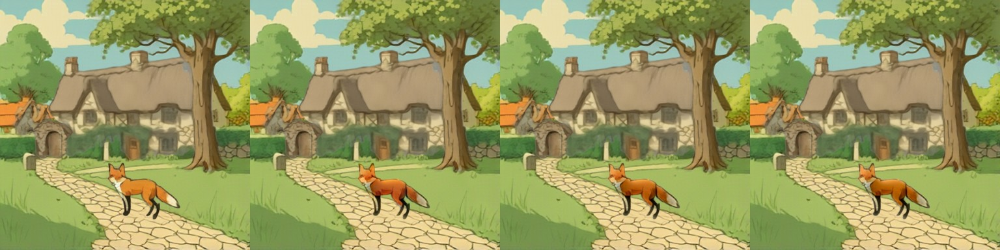
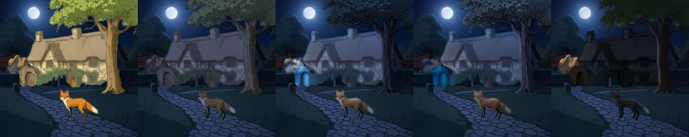
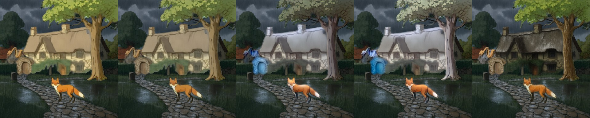

# IC-Light and relighting layers

> **Role: current factsheet** (components, not a layer model; library code, not wired into the page). Template: [TEMPLATE.md](TEMPLATE.md). Verdicts are the owner's.

> **Owner assessment (2026-11-11):** Could be tuned and tested further, but generally quite good at relighting, especially together with Qwen-2.1. IC-Light is not completely superseded by Qwen-2.1; that is to be shown with more testing and evidence.

## What it does

Changes the lighting of one RGBA layer so it fits a new scene (night, rain, a lantern). Three routes measured: **IC-Light v1 fbc** (SD1.5, relights against a given background), a **colour grade** (instant, CPU) and a **Qwen-Image-2.1 RGBA edit** with a relight prompt, retried when the alpha does not survive ([qwen-image-2.1.md](qwen-image-2.1.md)).

## Licence & weights

IC-Light v1 fbc: Apache-2.0 (Realistic Vision 5.1 UNet widened from 4 to 12 input channels). Qwen-Image-2.1: Qwen Research licence (non-commercial). IC-Light v2 (FLUX) never released weights.

## How we run it

1. IC-Light: [`relight.py`](../../prototype/layerproto/relight.py) (foreground with transparent pixels filled grey and background latents concatenated each step; the layer's alpha is re-applied and fine detail transferred); `restore_chroma(relit, original, keep)` pulls the colour back ([editing.md §2](../concepts/editing.md)).
2. Colour grade: `events.grade()` plus procedural overlays (rain, snow, fog, smoke, fire glow).
3. Qwen-2.1 per layer with the alpha check-and-retry: `layer_edit.py`, applied per plan by `event_apply.py`.

## Benchmarks (fox & cottage)

| Route | Compute | Result |
|---|---|---|
| IC-Light fbc, fox relit in place in the day scene (384 px, 8 steps) | 44 s on the laptop CPU, seconds on a T4 [est] | lightness down (Lab L 54.8 → 46.1), redness up (a* 15.2 → 20.3); `restore_chroma` keep 0.5-0.8 brings a* to 17.8-16.4 |
| Qwen-2.1 relight of all five layers, night and rain (512 px) | 20-26 s per edit, 547 s for 10 incl. retries | 10 of 10 accepted, 4 on the second try |
| Colour grade + overlay | milliseconds | an instant preview, not a real relight |

### Night: tuning IC-Light (CPU, 384 px, 8 steps, about 200 s per variant for five layers)

Objects are RevealLayer's layers; the background is the Qwen-2.1 night edit of its filled background. Variants: objects unchanged (mean grey 73.6); colour grade only (48.0); **A** IC-Light plain (62.0); **B** grade first, then IC-Light (46.1); **C** IC-Light then lightness match (47.6); **D** grade, IC-Light, lightness match (45.4). The night strip further down shows unchanged, grade, B, D and Qwen-2.1 side by side; A and C are described in the list and not shown as images.

- **A:** the cottage glows white-blue like snow, the arch is a cyan blob; not dark.
- **Grade only:** dark, desaturated, flat; darkest natural look, no cool moonlight cast.
- **B (the best IC-Light variant):** muted grey-blue cottage, dark tree, brown fox; a cool moonlit cast the plain grade lacks.
- **C:** the global lightness match does not fix A. **D** is close to B.
- **Every IC-Light variant turns the arch layer cyan** (it is a malformed RevealLayer layer); the grade does not.

### Against the Qwen-2.1 per-layer relight (night and rain, CPU, 384 px)

Tiles: objects unchanged | colour grade | IC-Light B | IC-Light D | **Qwen-2.1 per layer**. Mean grey of the composite in brackets (background alone 33.1 night, 52.1 rain).

Night (unchanged 73.6, grade 48.0, B 46.1, D 45.4, **Qwen-2.1 32.4**):

Rain (unchanged 82.7, grade 79.3, B 74.1, D 80.1, **Qwen-2.1 62.4**):

- **Night:** Qwen-2.1 is the darkest and most consistent with the background, but the cottage is nearly a black silhouette and the fox almost black; the arch fell back to the unlit original. IC-Light B/D give a usable cool cast.
- **Rain:** IC-Light hardly darkens anything (74-80) and turns the cottage and tree pale grey-white; Qwen-2.1 gives dark wet-looking thatch and walls, the most convincing.

**Reading:** Qwen-2.1 per-layer relight is clearly better for night and rain on these layers; IC-Light with a night pre-grade is usable at night and fails in the rain. IC-Light was not beaten where it is meant to work, matching a daylight object inside a daylight scene (the fox in the move strip), which these tests do not include. Untested: a stronger rain pre-grade, other prompts and steps, `restore_chroma` on these variants, sun-to-shade mismatches. The owner's "not superseded" stays open until those run.

### Whole-scene strategies and attribution

In the `bg_relight` strip ([editing.md §5](../concepts/editing.md)) the convincing night is Qwen-2.1's edit of the filled background; the IC-Light objects are pale blue-white with a yellowish fox and barely darker (mean grey 74 → 65 at night, 85 in the rain). In the per-layer strip both background and objects are Qwen-2.1's; only the layers (and a malformed tan gate-arch stump) come from RevealLayer. IC-Light on ART+ objects added colour casts ([art-plus.md](../ideas-considered/models/art-plus.md)).

## Special features

| Feature | Status |
|---|---|
| Relight a layer | **IC-Light: partial** (matches a daylight fox; night / rain objects come out pale); **Qwen-2.1: supported** (10 of 10 with the retry); grade: preview only |
| Story composite | the edit is Qwen-2.1's; IC-Light on night / rain objects was poor ([provenance.md](provenance.md)) |
| Harmonise after a move | partial ([relocate-harmonise.md](relocate-harmonise.md)) |
| Others | n/a |

## Best features / Weak spots

- **Best:** IC-Light matches light to a given background at layer level; the Qwen-2.1 route follows text ("heavy rainstorm").
- **Weak:** IC-Light shifts hue (partly fixable), has no notion of light sources (a campfire is dimmed at night) and adds casts to pale walls; Qwen-2.1 floods or empties a layer without the retry and can over-darken; the grade is not physically a relight.

## Status / Next attempts

IC-Light tested on CPU, Qwen-2.1 route measured on a T4; neither is in a server profile or the page. Next: a `/relight` route (Qwen-2.1 edit + retry) in the Qwen-2.1 profile; the untested IC-Light variants above. Sources: IC-Light repository, [editing.md](../concepts/editing.md), [object_harmonisation.md](../../research_notes/Layered%20loop%20open%20paths/object_harmonisation.md).
