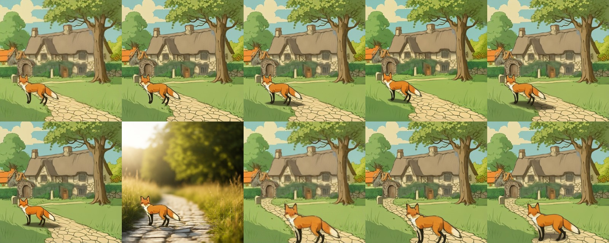

# relocate(): move / resize a layer with re-harmonisation

> **Role: current factsheet** (an approach we built, library code not wired into the page). Template: [TEMPLATE.md](TEMPLATE.md). Verdicts are the owner's.

> **Owner assessment (first look, 2026-11-11):** Interesting and very fast, but moving and resizing is probably best done by direct user interaction with individual layers (the canvas editor does this). Re-harmonising could still be useful.

## What it does

Training-free move and resize of one RGBA layer with re-harmonisation (after DreamLayer): paste the object into its new box, re-noise the composite to a low strength, denoise with SDXL + LayerDiffuse `bg2ble` while the object's interior latents are pinned for most steps, then extract the object again by mask (alpha plus the ring that changed). The object keeps its identity; rim and surrounding light adapt and contact shadows can grow. Parameters and versions: [editing.md §1](../concepts/editing.md).

## Licence & weights

Uses the LayerDiffuse SDXL chain ([layerdiffuse-sdxl.md](../ideas-considered/models/layerdiffuse-sdxl.md): SDXL base + LayerDiffuse weights, their non-commercial terms apply). No extra weights. Optional: [relight-ic-light.md](relight-ic-light.md), [shadow-layers.md](shadow-layers.md).

## How we run it

1. `LayerDiffuseChain.relocate()` in [`layerdiffuse_chain.py`](../../prototype/layerproto/backends/layerdiffuse_chain.py); remote route `POST /chain/relocate`. Not offered in the page: moving and resizing there is direct manipulation in the canvas editor (no model).
2. Defaults: `strength` 0.3-0.45, `pin_frac` 0.4, `band` 4-9 px, Euler, mask extraction, `paste_back` 0.8.

## Benchmark (fox & cottage)

Input: RevealLayer's split (filled background + five layers); the fox moved 28 % left, 4 % up, scaled 1.15×.

3.4 s per edit on a T4 at 512 px (first call 133 s including the SDXL download); strength 0.3 and 0.45 look alike; the fox is kept and its edges blend into the path. The whole loop (move, harmonise, shadow, relight) took about 9 s without IC-Light.

## Can Qwen-Image-2.1 replace it? (test 2026-11-11)

Fox moved by a plain paste (and at 1.6× as a harder case), edited by Qwen-2.1 at 512 px, 8 steps. "Outside" = PSNR / mean grey difference to the naive paste away from the fox; the **control** asks the editor to change nothing, so it shows its own drift.

| Job | Compute | Outside the fox | What the image shows |
|---|---|---|---|
| control ("keep the picture exactly the same") | 29.2 s | 30.9 dB | the whole picture is redrawn slightly, fox in the same pose |
| harmonise, seed 42 | 21.9 s | 30.5 dB | **a clear soft cast shadow under the feet**, same pose; outside as the control |
| harmonise, seed 7 | 23.1 s | **17.3 dB** | the whole picture re-composed: **seed-unstable** |
| shadow only | 24.4 s | 27.6 dB | a larger, darker shadow over the stones, fox unchanged |
| two references (fox layer + scene without it) | 27.6 s | 30.0 dB | placed with a shadow but **re-posed** |
| layer relight (RGBA fox, "stands on a sunlit path") | 22.9 s | n/a | **not a layer edit**: a whole sunlit scene around a copy of the fox |
| harder case 1.6×, harmonise | 23.6 s | 30.8 dB | the large fox re-rendered (inside diff 39) with a faint shadow |

Qwen-2.1 makes a convincing contact shadow in the scene's flat style and keeps the pose, as `relocate()` plus the procedural shadow layer do. Against it: 22-29 s instead of 3.4 + 0.5 s, it redraws the whole picture (about 31 dB, so no use where the other pixels must stay exact), one of two seeds shifted the picture, and a reference-based placement re-posed the fox. So it is a candidate for a "make it look placed" button on a flattened composite, not a drop-in for `relocate()`. A lighting mismatch case (sun to shade, or into the night scene) is not tested.

## Special features

| Feature | Status |
|---|---|
| Move / resize a layer | **supported** (3.4 s) |
| Harmonise after a move | **supported** |
| Add / remove / modify a layer | partial: the moved layer is replaced by the harmonised one; the old place needs a filled background |
| Relight | partial: combine with IC-Light |
| Split, story composite, image to image, amodal | n/a |

## Best features / Weak spots

- **Best:** seconds per edit; identity largely kept; contact shadows and light adapt.
- **Weak:** thin parts at the edge can change; identity drifts over repeated moves (pin length does not help); the old position needs a filled background (RevealLayer's or [amodal-fill.md](amodal-fill.md)); ART+ objects keep their glossy style and gain halos at strength 0.6 ([art-plus.md](../ideas-considered/models/art-plus.md)); one object and scene tested.

## Status / Next attempts

Works on fox & cottage as library code and a server route. Next: wire it behind the editor's selected layer, and run it through the tunnel. Sources: DreamLayer (harmonisation), [editing.md](../concepts/editing.md).
