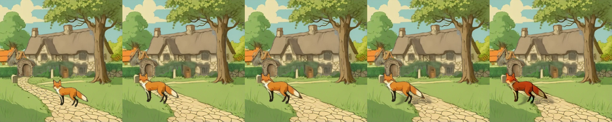

# RevealLayer (ICML 2026)

> **Role: current factsheet** (inpainting / box-controlled splitter). Template: [TEMPLATE.md](TEMPLATE.md). Verdicts are the owner's.

> **Owner assessment (2026-11-11):** Good layer removal and background inpainting. Layer extraction ok but very slow (it seems to need the time); the layers follow the boxes, which could be useful. Considering how slow it is, RevealLayer might be best just for inpainting (if sensible), not for layer splitting.

## What it does

Image + one box per object → RGBA layers **including the hidden parts** (amodal completion), plus a background with the objects removed and filled in.

## Licence & weights

Code Apache-2.0 ([360CVGroup/RevealLayer](https://github.com/360CVGroup/RevealLayer)); LoRA, `layer_pe`, refiner and transparent decoder on HF `qihoo360/RevealLayer`; base FLUX.1-dev (non-commercial).

## How we run it (happy path)

1. Kaggle 2× T4, profile `reveallayer` ([`serve/reveallayer.py`](../../prototype/layerproto/serve/reveallayer.py)); GGUF Q4_K_S FLUX.1-dev re-classed into RevealLayer's transformer; encoders/VAE from `ostris/Flex.1-alpha`; `transformers==4.57.1`; bundled diffusers 0.34. Load about 242 s.
2. `fp16_mixed` on the transformer plus these fixes for RevealLayer's own fp16 hazards (the official pipeline runs only bf16 at 1024 px, 30 steps):

   | Hazard | Our fix |
   |---|---|
   | ROI attention mask filled with −1e9 / `finfo.min` → −inf in fp16 | fill with −1e4 |
   | `layer_pe` fp32 added to fp16 states | cast to fp16 at load |
   | refiner `delta` residual unguarded | fp32 add + clamp |
   | VAE decode in fp16 ("odd purple output") | fp32 VAE and inputs |
   | hard-coded ViT-B/32 weight path | download + patch path |
   | refiner loader ignores missing keys | check the load message |

   A ComfyUI port (Ltamann/ComfyUI-TBG-RevealLayer) accepts fp16/bf16/fp32 FLUX but not GGUF. Details: [flux_layered_t4_and_weights.md](../../research_notes/Layered%20loop%20open%20paths/flux_layered_t4_and_weights.md).
3. 512 px, 12 steps, `true_gs` 1.0, boxes in pixels. To fit the fp32 decode with five boxes (seven frames) the transformer is offloaded before decoding.

## Benchmarks (2× T4, 512 px)

Forest, 3 boxes, 12 steps: 134 s (+ about 4 min load), peak 11.4 / 11.2 GB; a background with hidden areas filled plus three clean layers (pines, bare trees, campfire + chair).

Fox & cottage, five boxes (houses, cottage, arch, tree, fox); profile runs, warm model:

| | Settings | Compute | Layers | Diff |
|---|---|---|---|---|
| **A. Best case** | true_gs 3.5, 16 steps | 357.6 s | 6 | 10.84 |
| **B. Cheapest tried** (not under 30 s) | true_gs 1.0, 6 steps | 84.7 s | 6 | 13.5 |

(Earlier non-profile runs: 12 steps at true_gs 1.0 took 140 s, 16 steps at 3.5 took 334 s, the same split.) The negative-guidance pass is already skipped at true_gs 1.0, so the remaining cost is the step count.

A (strips: input | recomposite | filled background | layers):

B: the background is still a clean filled scene with cottage, tree and fox removed; the cottage layer carries a grey cast and ragged right edge, the houses layer is a small fragment:

## Special features

| Feature | Status | Evidence |
|---|---|---|
| Split an image into layers (with boxes) | **supported** | strips above |
| Move / resize a layer | **supported**: the filled background has no hole where the object was; the fox move loop uses this split | [editing.md §4](../concepts/editing.md) |
| Harmonise after a move | **supported** with `relocate()` | [relocate-harmonise.md](relocate-harmonise.md) |
| Spatial edit | **partial**: the boxes define the grouping | |
| Amodal completion | **supported**: hidden parts of objects and the background behind them | [amodal-fill.md](amodal-fill.md) |
| Story composite, image to image, relight, effects | not tried / n/a | |

## Best features / Weak spots

- **Best:** fills in what was behind each object, so the background stays complete when an object moves; layers follow the given boxes exactly (controllable grouping, e.g. from an LLM breakdown).
- **Weak:** slow (85-360 s per split, 30 s not reached); needs boxes; heavy setup; FLUX.1-dev licence.

## Status / Next attempts

Works on 2× T4. Next: use it as the background filler for moves rather than as the splitter; fox & cottage with LLM boxes; a second scene; 768 px if memory allows. Sources: [flux_layered_t4_and_weights.md](../../research_notes/Layered%20loop%20open%20paths/flux_layered_t4_and_weights.md); [../log.md](../log.md).
