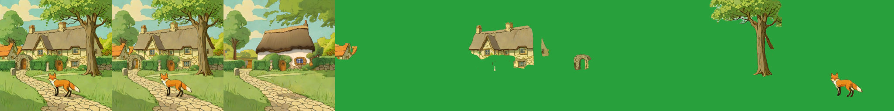
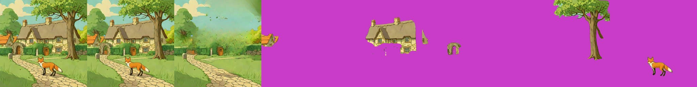
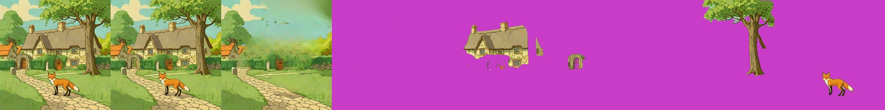

# SAM2 + Grounding DINO + LaMa (segment by name, inpaint)

> **Role: current factsheet** (a route built from three helper models). Template: [TEMPLATE.md](TEMPLATE.md). Verdicts are the owner's.

> **Owner assessment (first look, 2026-11-11):** SAM2: very fast, but quite bad layer splitting and inpainting (the inpainting is modular: another model can do it). Grounding DINO: layer extraction not the best, but very fast.

## What it does

Build-your-own decomposition: **Grounding DINO** turns a name ("red fox", "stone gate arch") into a box, **SAM2** cuts the object out of the box as a mask, each mask becomes a layer, and **LaMa** inpaints the holes in the background (optionally SDXL-inpaint for the hidden parts, [amodal-fill.md](amodal-fill.md)). With names only, a scene splits fully automatically.

## Licence & weights

SAM 2.1 (hiera-small) Apache-2.0; `IDEA-Research/grounding-dino-tiny` Apache-2.0 (about 0.7 GB, `AutoModelForZeroShotObjectDetection`); LaMa (`simple-lama-inpainting`, Apache-2.0, installed with `--no-deps`). All public and light; the other helper models we looked at are in [../research/hosting.md](../research/hosting.md#4-matting-segmentation-and-helper-tools).

## How we run it (happy path)

Kaggle T4, server profile `sam2` ([`layerproto/serve/sam2.py`](../../prototype/layerproto/serve/sam2.py)), method `sam2-lama` on `/decompose`; about 40-45 s to load everything. `DecomposeParams.names` goes through `Sam2Decomposer._box_for` (text `"<name>."`, threshold 0.3 / 0.25, the highest-scoring box); `boxes` skip the detector; `amodal=True` fills the hidden parts with SDXL-inpaint (the app's **Complete hidden parts** checkbox).

## Fox & cottage (one mask per named object)

| Variant | Time | Result |
|---|---|---|
| A: hand boxes → SAM2 | 8 s | village house, cottage, gate arch, tree, fox: clean cut-outs; recomposite diff 1.27 |
| **B: names → Grounding DINO → SAM2** (fully automatic) | 7 s | the same except "village houses" (boxed the cottage instead); diff 1.30 |
| C: automatic masks, the 5 largest (no detector) | 9 s | fragments (cloud, bush, lawn piece, path; on the forest moon, stump, flame) |

Weak spots: the LaMa background is blurry where large objects were removed, hidden parts stay missing (the cottage keeps holes where the tree and hedge cover it), and a first test used a picture with the box outlines painted on it, so the lines were cut out as part of the objects (the clean picture is `prototype/test_scene/fox_cottage.png`).

### Background fill: LaMa vs SDXL-inpaint (hand boxes, T4)

| Fill | Time (whole route) | Look |
|---|---|---|
| LaMa | 13 s | blurry, smeared texture over the removed cottage + tree + fox area |
| **SDXL-inpaint 1.0** (fp16-fix VAE, 30 steps, scene prompt, negative "fox, animal, person") | 28 s | sharp, in the scene's style, a plausible new cottage behind; but **invents content** (a different cottage, no village houses) |

LaMa fill (left strip) vs SDXL fill (right strip): input | recomposite | background | five object layers.

## Benchmark (warm model in one Kaggle session, 2026-11-11, second of two runs)

| | Request | Compute | Layers | Recomposite diff |
|---|---|---|---|---|
| **A. Best case: hand boxes** | five boxes, SAM2 + LaMa | 3.3 s | 6 | 1.33 |
| **B. Live-demo budget: names only** | five names, Grounding DINO → SAM2 + LaMa | 2.8 s | 6 | 1.44 |
| with SDXL-inpaint amodal fill | four boxes, `amodal=True` (first request, includes loading SDXL) | 101 s | 5 | 1.24 |

The amodal fill result (top row of [the amodal strip](../img/sam2_amodal_v2.jpg)) is the same split with the hidden parts of the cottage filled in.

## Special features

| Feature | Status | Evidence |
|---|---|---|
| Split an image into layers | **supported** | strips above |
| Move / resize a layer | **partial**: a canvas move; the LaMa background has a smeared patch at the old place | [relocate-harmonise.md](relocate-harmonise.md) |
| Spatial edit, add / remove / modify | **supported**: boxes and names pick the objects, a layer per name | |
| Amodal completion | **partial**: SDXL-inpaint fill option, patchy | [amodal-fill.md](amodal-fill.md) |
| Story composite, relight, effects | n/a | |

## Best features / Weak spots

- **Best:** very fast (3-9 s); exact pixels kept (recomposite diff about 1); every part public and light; names go straight to boxes with no training.
- **Weak:** automatic "largest K" masks pick fragments; composite phrases ("village houses") can box the wrong thing; one box per name; hidden parts stay missing; the fill is blurry (LaMa) or invents content (SDXL-inpaint).

## Status / Next attempts

Works by name: meaningful object layers fully automatically in 3-7 s; the only splitter that meets the 30 s live-demo budget by itself. Next: take the fill from Qwen-Image-2.1 instead of LaMa (combination B in [pipeline-plan.md](pipeline-plan.md)), several boxes per name, a score threshold per name; pix2gestalt not tried. Sources: [other_psd_methods.md](../../research_notes/Layered%20methods%20deep%20dive/other_psd_methods.md) §1, the Grounding DINO paper and the `IDEA-Research` model card.
