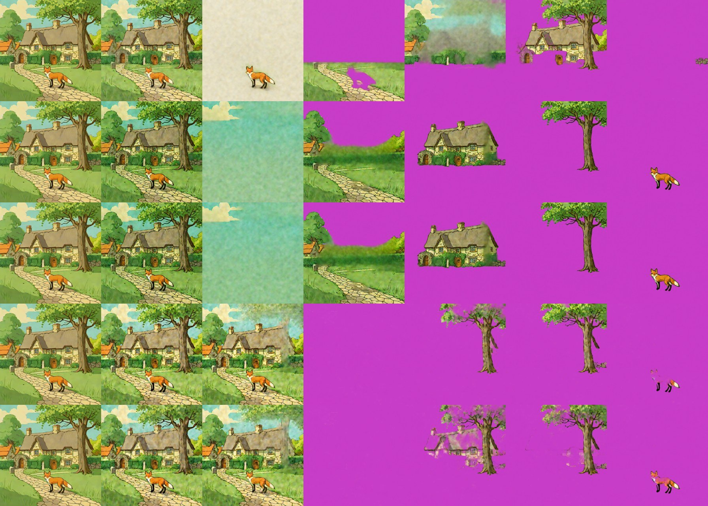
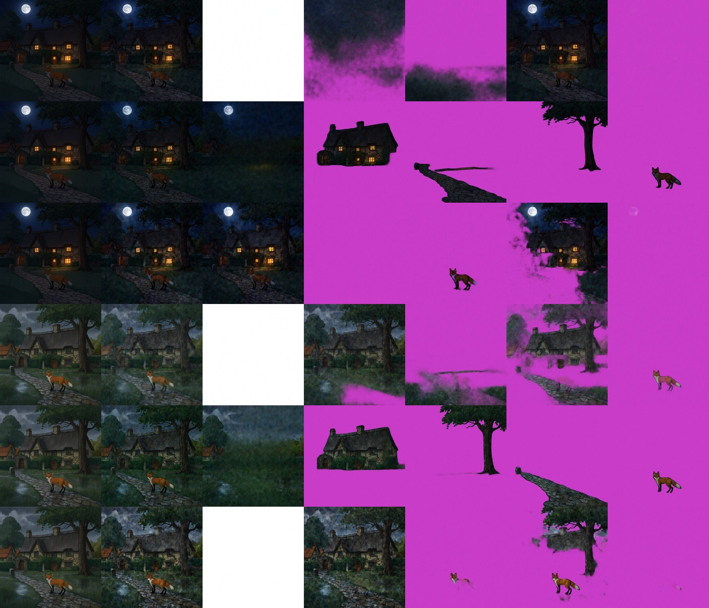

# Stable-Layers (Stability AI)

> **Role: current factsheet** (the splitter for story composites). Template: [TEMPLATE.md](TEMPLATE.md). Verdicts are the owner's.

> **Owner assessment (2026-11-11):** Pretty solid layer extraction, particularly useful for story composites (with a Qwen-Image-2.1 edit). Keep Stable-Layers and CLD as options for splitting unless Qwen-2.1 has an absolute advantage; runtime matters too.

## What it does

An RL-tuned LoRA (330 MB, PEFT, 420 modules) on top of Qwen-Image-Layered, trained with a VLM teacher for cleaner semantic splits. Image in, N RGBA layers out (N chosen per run).

## Licence & weights

Stability AI Community licence (free below $1M revenue, attribution). `StabilityLabs/Stable-Layers`.

## How we run it (happy path)

Same stack and profile (`qwen-layered`) as [qwen-image-layered.md](qwen-image-layered.md); the LoRA is attached unmerged with `fp16_mixed.add_lora` (all 420 modules match) and swapped in a few seconds. **640 px, 5 layers, 4 Euler steps, CFG 1** (about 100 s); Heun (`decompose(..., sampler="heun")`) gives the same layers for 76 s more. The model card asks for Heun, 50 steps, 640 px.

## Benchmarks (2× T4, warm model)

Native 640 px, fox & cottage and the Qwen-2.1 night / rain edits, checked layer by layer:

| Case | Compute | Recomposite diff |
|---|---|---|
| fox & cottage, 4 Euler steps | 101.7 s | 18.48 |
| fox & cottage, 4 Heun steps | 177.7 s | 18.41 |
| night composite, 4 Heun steps | 178.6 s | 4.61 |
| rain composite, 4 Heun steps | 178.2 s | 11.35 |

Lower resolutions on fox & cottage (diff is about 2× the base model's because of a colour shift):

| Setting | Compute | Diff | Layers |
|---|---|---|---|
| 384 px, 4 Euler steps | 39 s | 21.0 | sky / meadow / cottage + tree / path / fox |
| 384 px, 4 Heun steps | 67 s | 20.6 | the same |
| 384 px, 3 Euler steps (profile run) | 30.9 s | 23.2 | fox separated; cottage and tree one block |
| 512 px, 8 Heun steps (profile run) | 248 s | 16.1 | bands: sky, cottage + arch, tree + path, fox |

**The resolution is what matters on this scene.** Below 640 px the objects come out as bands or blocks; at 640 px every object is its own layer. A 30 s budget at 640 px is not reached (2-3 steps there are not measured).

**Fox & cottage at 640 px (Euler and Heun rows):** layer 0 a sky wash with a cloud, objects removed (colour difference to the input 54 / 70 / 83 for cottage / tree / fox); layer 1 hedge, meadow and path without the fox, the path filled where the fox stood; layer 2 the cottage with its gate arch, a clean cut-out; layer 3 the tree; layer 4 the fox (2.8 % of the canvas). The first split of this scene with one object per layer and a hole-free background. Euler and Heun give the same layers.

**Story composites at 640 px** (rows: night base, **night Stable-Layers**, night Lightning, rain base, **rain Stable-Layers**, rain Lightning):

- **Night:** dark sky with moon and landscape; cottage with lit windows as a clean cut-out; path; tree; fox. The window light stays on the cottage layer.
- **Rain:** grey sky and wet greenery; cottage; tree; wet path; fox, all clean.

At 384 px (Heun, 67-70 s) the same edits split into moon + sky bits / cottage with lit windows / tree / fox (night, diff 4.2) and cottage / tree / fox plus a wet-path layer (rain, diff 11.2); the 640 px strip above is the cleaner result.

**Against Qwen-2.1 extraction on the same edits:** Qwen-2.1 (138.7 s / 184.3 s) left the cottage and tree in the background, cut a block for the cottage and invented a misplaced arch ([qwen-image-2.1.md](qwen-image-2.1.md)); Stable-Layers at 640 px split both edits cleanly in 178 s (Heun). That measured advantage keeps it as the splitter for story composites. On the daylight scene Qwen-2.1 extraction gives a clean background and whole objects but a mis-scaled arch.

**Other scenes** (384 px, 4 Heun steps, 58-61 s, diff 15.5-17.9): the forest background comes out very clean (trees and campfire removed and filled), trees split into clean layers; on the sketch the background is truly empty paper and the fire gets its own layer, but the skeleton, fire and logs stay in one layer.

## Special features

| Feature | Status | Evidence |
|---|---|---|
| Split an image into layers | **supported** | strips above |
| Move / resize a layer | **partial** (canvas move; no harmonising) | [relocate-harmonise.md](relocate-harmonise.md) |
| Story composite | the edit is Qwen-2.1's; Stable-Layers **splits** the night and rain edits (clean at 640 px) | [provenance.md](provenance.md) |
| Add / remove / modify a layer | **partial** (N chosen per run) | |
| Amodal completion | **supported** (background filled behind objects) | strips above |
| Spatial edit, image to image, relight, effects | n/a | |

## Best features / Weak spots

- **Best:** cleaner semantic separation than the base model; one clean layer per object and a filled background at 640 px; the best splitter for the story composites.
- **Weak:** colour and contrast shift (recomposite about 2× further from the input than the base model); about 100 s at 640 px; bands/blocks below 640 px.

## Status / Next attempts

Works; served through the `qwen-layered` profile. Next: 2-3 steps at 640 px for a faster split, colour correction (match the recomposite's colour statistics to the input). Sources: [../log.md](../log.md), the model card.
